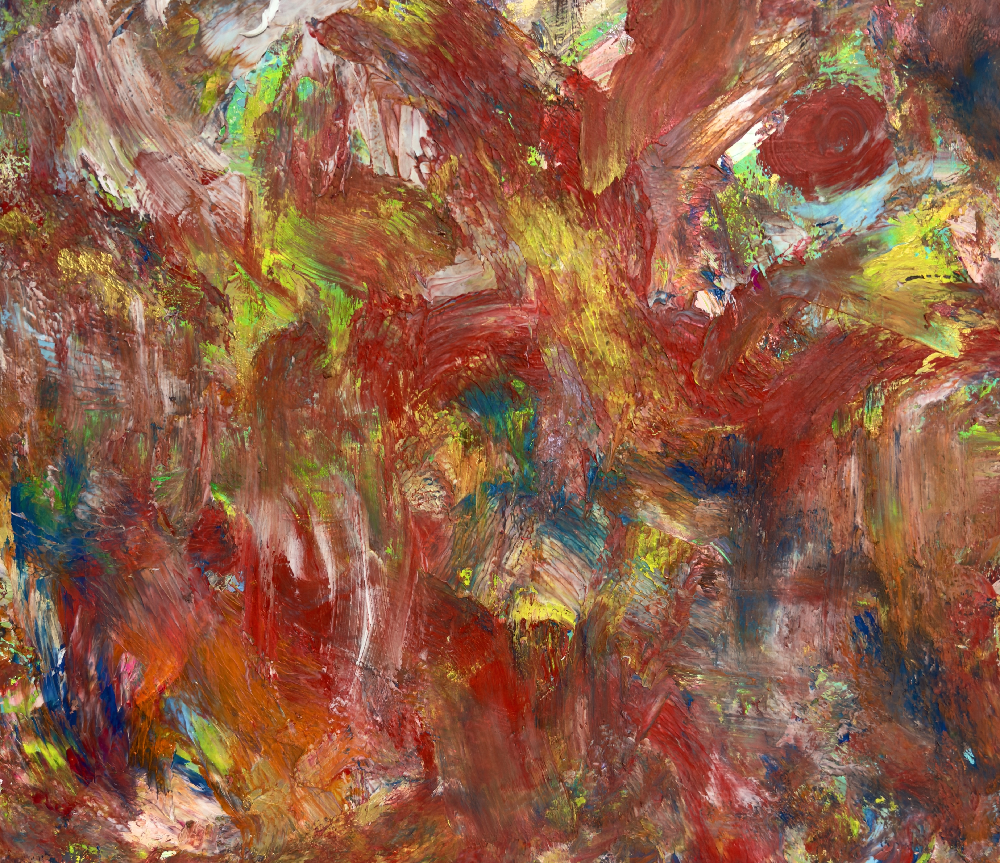
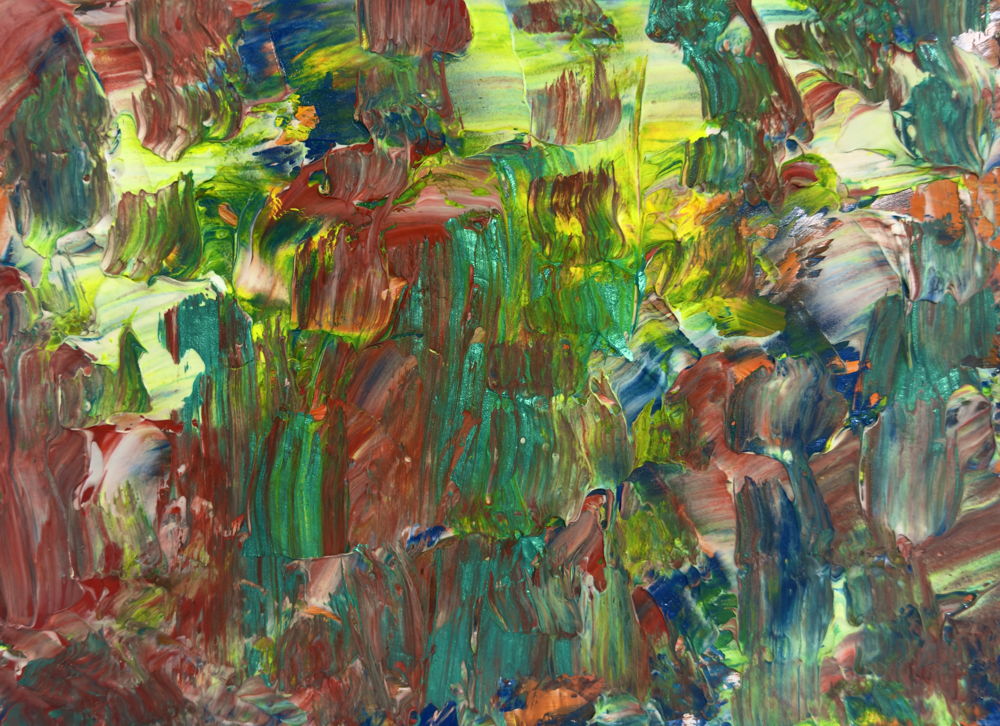
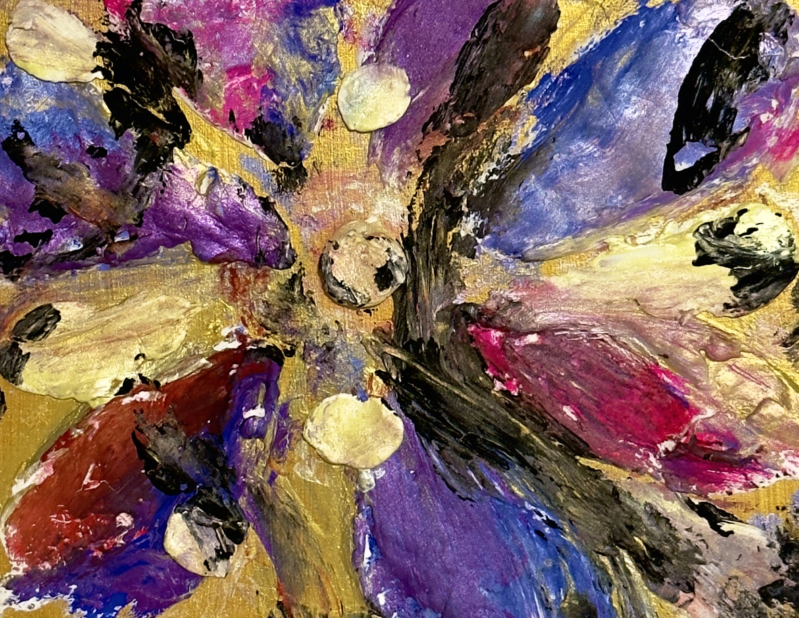
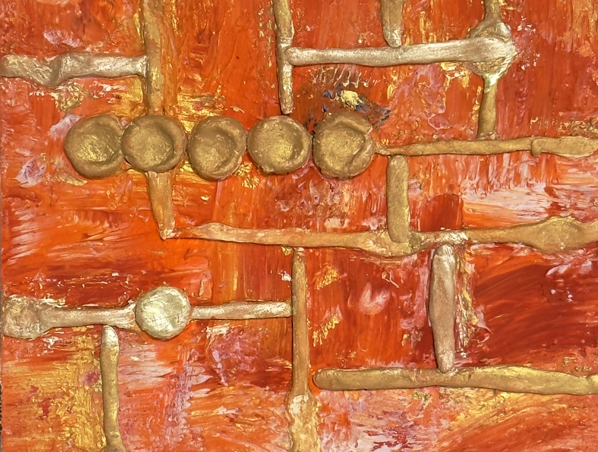
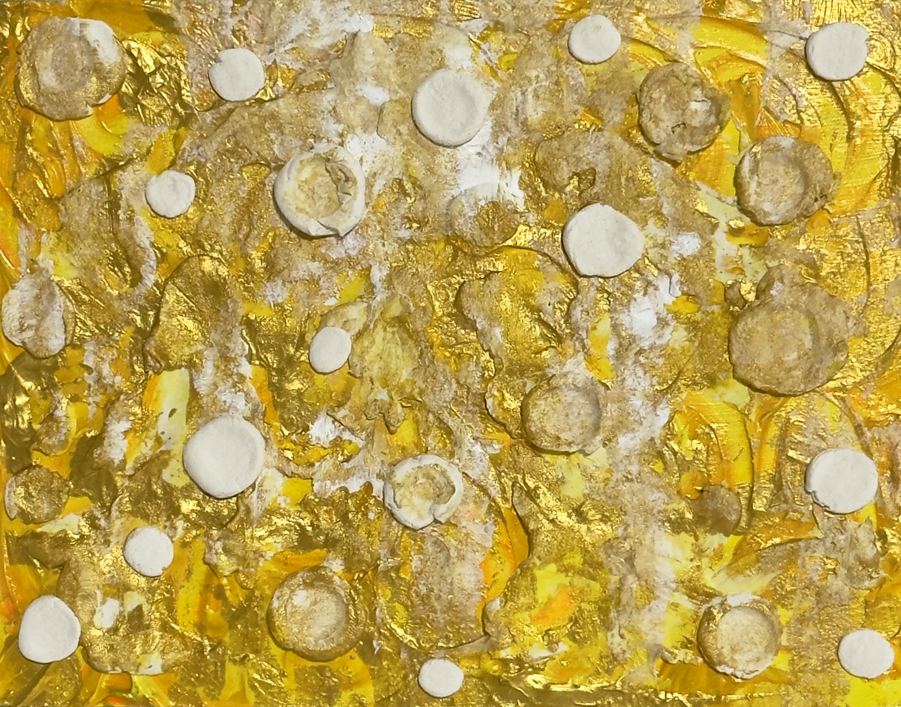

# 作品素材一覧

各フォルダに原画の写真 `painting.jpg` と作品情報 `work.json` があります。ファイル形式の詳細は [WORK_FORMAT.md](../docs/WORK_FORMAT.md) に記載しました。

## 2026年11月6日追加：金沢展の5点

既存の「Harmoney」に、ハイアットハウス金沢展の作品5点を追加しました。小品3点とF4・F10の2点を選び、色合いと大きさの異なる作品を揃えています。

寸法は **幅 × 高さ**、単位はcmです。5点とも2026年制作、技法・支持体は「シナベニヤにミクストメディア」です。

| 作品画像 | 作品名 / 英語表記 | 号数 | 幅 × 高さ | 作品情報 | 写真の画素数 |
| --- | --- | --- | --- | --- | --- |
|  | 頂 / itadaki | F10 | 53 × 45.5 | [work.json](itadaki/work.json) | 4759 × 4110 |
|  | 本能 / Instinct | F4 | 33.3 × 24.2 | [work.json](instinct/work.json) | 5033 × 3654 |
|  | 内なる心に咲く花よ / The Flower Within | F0 | 18 × 14 | [work.json](the-flower-within/work.json) | 1660 × 1285 |
|  | Golden Path | F0 | 18 × 14 | [work.json](golden-path/work.json) | 1633 × 1235 |
|  | New Chapter | F0 | 18 × 14 | [work.json](new-chapter/work.json) | 1683 × 1322 |

## 情報の出典と写真の扱い

- 作品名・英語表記・制作年・号数・画材は作品台帳と照合し、寸法は金沢展の作品名入りキャプションで確認しました。写真の向きに合わせて幅・高さを登録しています。関連する公開ページは [ハイアットハウス金沢展](https://sheerarts.com/exhibitions/hyatt-house-kanazawa-2026) です。
- 元写真は金沢展の作品写真 `01_頂.jpg` から `05_New Chapter.jpg`。JPEGの画素と色プロファイルを保ち、位置情報・撮影機器情報などのメタデータを除去しました。
- F0の3点は元写真の長辺が1633〜1683pxです。撮影推奨の2000pxには届かないため、収録画像の解像度を上表に記載しました。
- 金沢での出展を資料で確認しました。制作場所については未確認です。
- 作家のメッセージ・音声・物語は未登録です。`messages` と `messages_en` は空配列にし、制作意図の文章は作成していません。
- 販売状況は更新が必要な情報のため、今回の追加データでは省略しています。

## 表示用ファイル

各作品の `generated/` は既存の生成処理で作成した、表示用画像・流れ場・部屋への合成・QRなどです。翻訳・物語生成APIは使用していません。QRの行き先は既存設定に従うもので、今回の素材追加はサイト公開を意味しません。

## 既存作品

- [Harmoney](harmoney/work.json)：F15、幅53 × 高さ65.2cm。既存の作品素材と作家の文章を保持しています。
